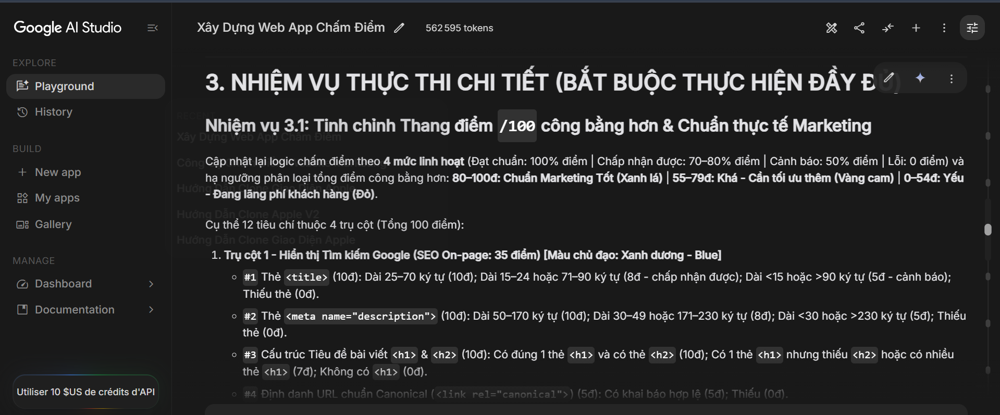
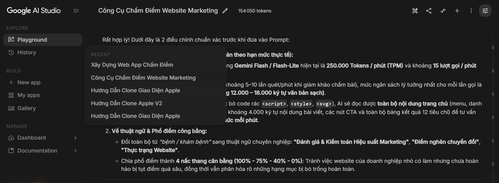

# 🤖 MINH CHỨNG LÀM CHỦ VIBE CODING & PHẢN BIỆN KỸ THUẬT — JYABINAI

## 1. Phương pháp làm chủ Vibe Coding của Đội (Human-in-the-loop Architecture)
Đội không sử dụng AI theo kiểu "giao phó toàn bộ bằng 1 câu lệnh", mà áp dụng quy trình **Kỹ thuật Phần mềm có Kiểm soát (Structured Vibe Coding)** qua 4 giai đoạn:
1. **Thiết kế Nghiệp vụ & Trọng số trước khi sinh code:** Đội chủ động định nghĩa ma trận 100 điểm chia làm 04 trụ cột Marketing thực chiến cho doanh nghiệp SME (SEO 35đ - Social 25đ - Mobile 20đ - Conversion 20đ) với phổ điểm 4 mức cân bằng.
2. **Phân rã Kiến trúc Module hóa (6 Files):** Yêu cầu AI tách biệt rõ giao diện (`index.html`, `style.css`), dữ liệu mẫu (`config-samples.js`), bộ quét & chấm điểm (`scanner-scorer.js`), bộ não AI (`ai-engine.js`) và bộ điều phối (`ui-controller.js`).
3. **Kiểm thử thực tế & Phản biện ngược (Critical Debugging):** Sau mỗi phiên bản, đội chạy kiểm thử thực tế trên cả Desktop và Mobile (iOS Safari/Android), phát hiện các điểm bất hợp lý của AI để yêu cầu sửa sâu vào thuật toán.

---

## 2. 02 Đoạn hội thoại & Tình huống Phản biện Kỹ thuật Tiêu biểu

### 🔹 Tình huống 1: Thiết kế thuật toán chấm điểm `/100` công bằng cho SME & Mô phỏng Live Preview
- **Prompt định hướng của đội:** *"Xây dựng thuật toán DOMParser chấm điểm /100 theo 4 trụ cột Marketing. Thay vì chỉ chấm Đạt/Trượt cứng nhắc khiến các web SME bị điểm quá thấp, hãy thiết kế thang điểm 4 mức linh hoạt (Đạt 100%, Khá 75%, Cảnh báo 40-50%, Lỗi 0%) và dựng khung Live Preview mô phỏng kết quả tìm kiếm Google & thẻ chia sẻ Zalo/Facebook."*
- **Kiểm tra & Phản biện của đội:** Phiên bản đầu tiên AI phạt mất 50% điểm chỉ vì thẻ `<title>` dài 68 ký tự. Đội đã phản biện và yêu cầu nới biên độ chuẩn lên `25–70 ký tự` (10đ) và `71–95 ký tự` vẫn đạt mức Khá (7.5đ) để phản ánh đúng thực tế hiển thị của Google hiện nay.
- 

### 🔹 Tình huống 2: Tối ưu ngân sách Ngữ cảnh 4.000–6.000 Tokens & Ép kiểu JSON Schema
- **Vấn đề phát hiện khi test:** Nếu chỉ gửi điểm số sang AI, lời nhận xét rất chung chung; nhưng nếu gửi nguyên mã HTML thô (nặng 300KB chứa đầy `<script>`, `<svg>`) sẽ gây tràn giới hạn Token và chậm phản hồi.
- **Chỉ đạo kỹ thuật của đội cho AI:** *"Xây dựng hàm `buildRichAiPayload` tạo bản sao `doc.body`, xóa sạch `<script>`, `<style>`, `<svg>`, chỉ trích xuất Menu dịch vụ, các thẻ H1–H3 và tối đa 6.000 ký tự nội dung chính (gói gọn trong 4.000–6.000 tokens). Đồng thời dùng `responseSchema` ép đầu ra trả về đúng 03 điểm mạnh & 03 điểm cần cải thiện theo ngôn ngữ tư vấn kinh doanh."*
- 
- 
