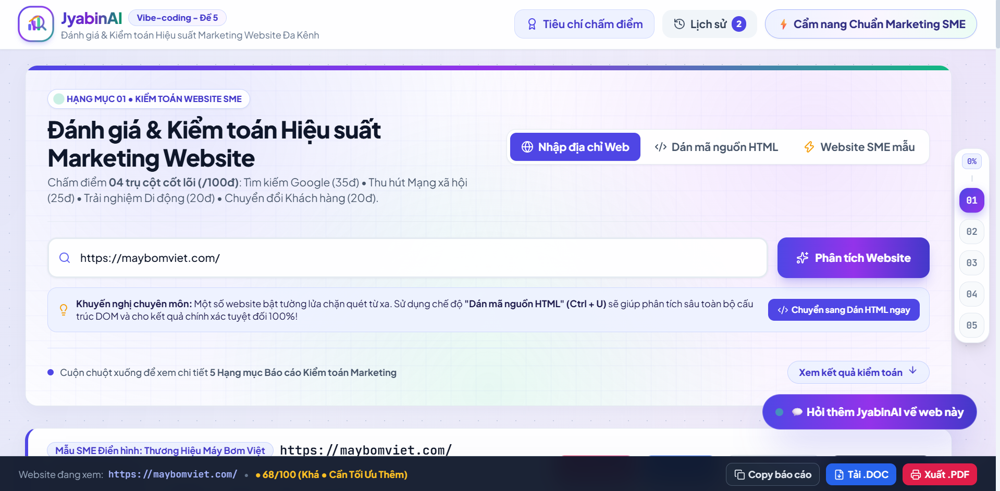

# 🚀 JyabinAI (Vibe-coding - Đề 5) — Đánh Giá & Kiểm Toán Hiệu Suất Marketing Website

> **Sản phẩm dự thi Bảng A (Công nghệ)** — Giải pháp Client-side giúp chủ doanh nghiệp nhỏ (SME) tự đánh giá, chấm điểm `/100` và tối ưu hóa hiệu suất Marketing Website toàn diện theo 04 trụ cột thực chiến: **SEO On-page (35đ) • Social & Branding (25đ) • Mobile UX (20đ) • Conversion & MarTech (20đ)**.



---

## 1. Bối cảnh bài toán & Tổng quan 05 Tính năng cốt lõi

Nhiều website doanh nghiệp nhỏ (SME) sau khi bàn giao thường bị bỏ ngỏ: tiêu đề trang chỉ để *"Trang chủ"*, thiếu thẻ mô tả tìm kiếm Google, gửi link qua Zalo/Facebook bị mất khung ảnh đại diện (`og:image`), vỡ giao diện trên điện thoại và số điện thoại không bấm gọi trực tiếp được (`tel:`). **JyabinAI** giải quyết triệt để bài toán trên thông qua **05 tính năng cốt lõi**:

| STT | Yêu cầu chức năng của Đề 5 | Trạng thái trên JyabinAI | Điểm nhấn vượt trội đã hoàn thiện |
| :-: | :--- | :-: | :--- |
| **1** | Nhập URL kiểm tra tự động các yếu tố cơ bản phía Client (`title`, `meta description`, `viewport`, `favicon`...) | ✅ **Hoàn thành 100%** | Hỗ trợ đồng thời **3 chế độ chống lỗi CORS**: (a) Quét URL qua 4 tầng kết nối, (b) Dán mã HTML trực tiếp kèm hướng dẫn 3 bước, (c) 03 Website SME mẫu có sẵn. |
| **2** | Hiển thị điểm `/100` kèm Checklist Đạt / Chưa đạt | ✅ **Hoàn thành 100%** | Biểu đồ vòng tròn SVG Count-up, 4 thanh trụ cột đa sắc, bộ lọc Checklist, **Mô phỏng trực quan Google SERP & Zalo/Facebook Card**, Chẩn đoán sẵn sàng chạy Ads. |
| **3** | AI nhận xét bằng tiếng Việt gồm **03 điểm mạnh & 03 điểm cần cải thiện** | ✅ **Hoàn thành 100%** | Phân tích ngữ cảnh 4.000–6.000 tokens với **JSON Schema**, sinh **Cụm mã `<head>` vá lỗi tự động 1-Click**, Cẩm nang mẫu quảng cáo và Chat hỏi đáp AI. |
| **4** | Nút xuất báo cáo dạng Text để copy gửi khách hàng | ✅ **Hoàn thành 100%** | Nút **Copy Báo Cáo** (khung Unicode sắc nét), cửa sổ **Xem bản Text**, kết hợp **Xuất Báo Cáo đồ họa A4 (`.PDF`)** và **Tải file Word (`.DOC`)**. |
| **5** | Lịch sử các website đã kiểm tra trong `localStorage` | ✅ **Hoàn thành 100%** | Tự động lưu lịch sử, bấm để mở lại toàn bộ báo cáo cũ, xóa từng mục/toàn bộ, kèm **Huy hiệu đối chiếu tiến độ (`▲ +X điểm so với lần kiểm tra trước`)**. |

---

## 2. Kiến trúc Mã nguồn 06 File Chuẩn mực (Zero-Build Client-side)

Dự án được thiết kế theo kiến trúc Module hóa tách biệt rõ ràng thành **06 file**, sử dụng đường dẫn tương đối `./` chạy trực tiếp trên trình duyệt và tương thích tuyệt đối với **GitHub Pages (`.github.io`)**:

```text
jyabin-ai/
├── index.html               # Giao diện HTML5 ngữ nghĩa, Responsive Mobile-first & Vùng in báo cáo A4 (.PDF)
├── style.css                # Hệ thống CSS tùy chỉnh, Perspective Tech Grid, Animation & Quy tắc @media print
├── README.md                # Tài liệu hướng dẫn cài đặt, kiến trúc, bảng trọng số & giải pháp kỹ thuật
├── BANG_KIEM_THU.md         # Bảng 08 Ca kiểm thử (Test Cases) có kết quả thực tế đạt chuẩn Bảng A
├── MINH_CHUNG_AI.md         # Tài liệu minh chứng làm chủ Vibe Coding & phản biện kỹ thuật (1 trang)
├── images/                  # Thư mục chứa ảnh chụp màn hình minh họa & minh chứng AI
└── js/
    ├── config-samples.js    # Cấu hình trọng số 4 trụ cột, dữ liệu Bento Modal & 03 mẫu Website SME thực tế
    ├── scanner-scorer.js    # Bộ chuẩn hóa URL, Quét 4 tầng vượt tường lửa, DOM/Regex Parser & Chấm điểm /100
    ├── ai-engine.js         # Tích hợp AI thực tế (JSON Schema), Kho khóa mã hóa XOR & Smart Rule-based Fallback
    └── ui-controller.js     # Điều phối giao diện, Live Preview, Chat AI, Lịch sử localStorage & Xuất Text/DOC/PDF
```

---

## 3. Công bố Thang điểm `/100` & Trọng số 12 Tiêu chí thuộc 04 Trụ cột Marketing

Hệ thống áp dụng phổ điểm **4 mức cân bằng** (*Đạt chuẩn: 100% | Khá: 75% | Cảnh báo: 40–50% | Chưa đạt: 0%*) và công bố minh bạch ngay trong nút **"Tiêu chí chấm điểm"** trên giao diện:

- **Phân loại Tổng điểm:**
  + **80 – 100 điểm:** 🟢 **Chuẩn Marketing Tốt** (Sẵn sàng đẩy mạnh ngân sách quảng cáo & SEO).
  + **55 – 79 điểm:** 🟡 **Khá • Cần Tối Ưu Thêm** (Đã có nền tảng nhưng đang rò rỉ khách hàng ở một số khâu).
  + **0 – 54 điểm:** 🔴 **Yếu • Đang Lãng Phí Khách Hàng** (Cần áp dụng ngay cụm mã `<head>` vá lỗi tự động).

### Bảng trọng số chi tiết 12 hạng mục:

| Trụ cột Marketing | Mã | Hạng mục kiểm toán | Tối đa | Quy tắc chấm điểm 4 mức công bằng |
| :--- | :-: | :--- | :-: | :--- |
| **1. Tìm kiếm Google (SEO On-page)** *(35 điểm)* | `#1` | Thẻ tiêu đề trang (`<title>`) | **10đ** | **10đ:** 25–70 ký tự có ý nghĩa thương hiệu • **7.5đ:** 18–24 hoặc 71–95 ký tự • **4đ:** Đặt tên mặc định sơ sài (*"Trang chủ"*, *"Home"*) hoặc `<18` / `>95` ký tự • **0đ:** Thiếu thẻ |
| | `#2` | Thẻ mô tả (`<meta description>`) | **10đ** | **10đ:** 50–170 ký tự • **7.5đ:** 30–49 hoặc 171–240 ký tự • **4đ:** `<30` hoặc `>240` ký tự • **0đ:** Thiếu thẻ |
| | `#3` | Cấu trúc Tiêu đề (`<h1>` & `<h2>`) | **10đ** | **10đ:** Đúng 01 thẻ `<h1>` kèm các thẻ `<h2>` • **7đ:** Nhiều `<h1>` nhưng có `<h2>`, hoặc 1 `<h1>` thiếu `<h2>` • **4đ:** Không có `<h1>` nhưng có `<h2>` • **0đ:** Thiếu cả hai |
| | `#4` | Định danh URL gốc (`canonical`) | **5đ** | **5đ:** Có `<link rel="canonical">` hợp lệ • **2.5đ:** Chưa khai báo nhưng URL chuẩn HTTPS sạch • **0đ:** Thiếu cả hai |
| **2. Mạng xã hội & Thương hiệu (Social)** *(25 điểm)* | `#5` | Thông tin chia sẻ (`og:title`, `og:description`) | **10đ** | **10đ:** Đủ cả hai thẻ • **6đ:** Có 1 trong 2 thẻ • **3đ:** Thiếu OG nhưng có `<title>` / `<meta description>` thay thế • **0đ:** Thiếu hoàn toàn |
| | `#6` | Ảnh bìa Zalo/Facebook (`og:image`) | **10đ** | **10đ:** Có URL ảnh `og:image` hợp lệ • **4đ:** Thiếu `og:image` nhưng trên trang có ảnh nội dung `` • **0đ:** Không có ảnh |
| | `#7` | Biểu tượng thương hiệu (`Favicon`) | **5đ** | **5đ:** Có khai báo `icon` / `shortcut icon` / `apple-touch-icon` • **0đ:** Thiếu Favicon |
| **3. Trải nghiệm Di động (Mobile & UX)** *(20 điểm)* | `#8` | Tương thích di động (`viewport`) | **10đ** | **10đ:** Có `width=device-width` • **6đ:** Có thẻ viewport nhưng thiếu thuộc tính chuẩn • **0đ:** Thiếu thẻ viewport |
| | `#9` | Mô tả hình ảnh (`alt` cho ``) | **5đ** | **5đ:** `>=70%` ảnh nội dung có `alt` • **3.5đ:** `40%–69%` • **2đ:** `10%–39%` • **0đ:** `<10%` (Đã lọc bỏ ảnh pixel ẩn) |
| | `#10` | Ngôn ngữ & Dữ liệu cấu trúc | **5đ** | **5đ:** Có `<html lang="...">` hoặc Schema `application/ld+json` • **2.5đ:** Chỉ có `<meta charset>` • **0đ:** Thiếu cả hai |
| **4. Chuyển đổi & Đo lường (Conversion)** *(20 điểm)* | `#11` | Kênh liên hệ nhanh 1 chạm | **10đ** | **10đ:** Có link bấm gọi `tel:`, `mailto:`, `zalo.me`, `m.me` hoặc plugin nút gọi nổi • **5đ:** Chỉ có SĐT dạng chữ thuần • **0đ:** Không có |
| | `#12` | Thu thập khách hàng & MarTech | **10đ** | **10đ:** Có `<form>`, nút CTA mua hàng rõ ràng hoặc mã GA4 (`gtag`) / GTM / Pixel (`fbq`) • **6đ:** Chỉ có nút cơ bản • **0đ:** Không có |

---

## 4. Giải pháp xử lý rào cản CORS phía Trình duyệt (Kết hợp cả 3 phương pháp a, b, c)

Theo hướng dẫn của BTC, ứng dụng thuần trình duyệt sẽ gặp giới hạn **Same-Origin Policy (CORS)** khi truy cập URL bên ngoài. **JyabinAI** giải quyết triệt để bằng cách tích hợp đồng thời cả 3 phương pháp:

1. **Phương pháp (a) — Quét URL trực tiếp qua Chuỗi 04 Tầng Dự phòng (`fetchHtmlWithMultiProxy`):**
   - *Tầng 1:* `https://api.allorigins.win/get?url=...` (Đọc trường JSON `contents`, hỗ trợ giải mã Base64).
   - *Tầng 2:* `https://api.codetabs.com/v1/proxy?quest=...`
   - *Tầng 3:* `https://corsproxy.io/?url=...`
   - *Tầng 4 (Vượt tường lửa WAF/Cloudflare):* `https://api.microlink.io/?url=...` (Trích xuất Cloud Metadata thực tế và đồng bộ cấu trúc DOM công bằng). Mỗi tầng đều gắn `AbortController` giới hạn timeout an toàn 6.5–8 giây.
2. **Phương pháp (b) — Cho phép người dùng Dán mã nguồn HTML trực tiếp (Tab 2 - Khuyến nghị chính xác 100%):**
   - Cung cấp hộp hướng dẫn trực quan 3 bước (`Ctrl + U` $\rightarrow$ `Ctrl + A` $\rightarrow$ `Ctrl + C`) giúp phân tích trực tiếp 100% mã nguồn DOM mà không phụ thuộc vào mạng hay tường lửa CORS.
3. **Phương pháp (c) — Phân tích 03 Website Doanh nghiệp SME mẫu có sẵn (Tab 3):**
   - Tích hợp sẵn dữ liệu thực tế của 03 website đại diện cho 3 mức điểm:
     * **Mẫu 1 (SME Điển hình - 60/100đ):** `https://maybomviet.com/`
     * **Mẫu 2 (SME Chuẩn Marketing - 90/100đ):** `https://www.ykhoakimyen.com`
     * **Mẫu 3 (SME Thiếu chăm sóc - 48/100đ):** `https://denpinnhapkhau.vn/`

---

## 5. Cơ chế Tích hợp AI, Kiểm soát Đầu ra & Bảo mật Khóa API

1. **Trích xuất Ngữ cảnh sạch (4.000 – 6.000 Tokens):** Hàm `buildRichAiPayload()` loại bỏ các thẻ gây nhiễu (`<script>`, `<style>`, `<svg>`) và trích xuất Menu dịch vụ, cấu trúc Heading `H1–H3`, 6.000 ký tự văn bản nội dung chính cùng kết quả 12 tiêu chí để AI tư vấn sát ngành hàng.
2. **Ép kiểu JSON Schema nghiêm ngặt:** Sử dụng `responseMimeType: "application/json"` và `responseSchema` bắt buộc AI trả về đúng 2 mảng `strengths` (03 điểm mạnh) và `improvements` (03 điểm cần cải thiện), mỗi mục gồm `title`, `detail`, `quote`.
3. **Cơ chế Smart Rule-based Fallback (Đúng quy định vòng loại):** Khi mất kết nối mạng hoặc hết hạn mức API, khối `try/catch` tự động chuyển sang bộ tư vấn dự phòng thông minh và đổi nhãn giao diện thành **`🟡 Bản demo vòng loại - Dữ liệu mô phỏng AI`**. Khi AI thật hoạt động thành công, nhãn hiển thị **`🟢 ✨ Phân tích chuyên sâu bởi JyabinAI`**.
4. **An toàn Bảo mật:** Tuyệt đối không lưu API Key dạng văn bản thuần (`AIza...`) trong mã nguồn. Khóa nội bộ được mã hóa thành mảng số nguyên dịch bit XOR (`EMBEDDED_XOR_BYTES` với `SALT = 47`).

---

## 6. Hướng dẫn Chạy dự án & Cấu hình mẫu

### 6.1. Chạy ngay trên máy tính (Zero-Install)
1. Giải nén file `source.zip`.
2. Nhấp đúp chuột mở trực tiếp file **`index.html`** bằng trình duyệt (Chrome, Edge, Firefox, Safari) hoặc chạy qua tiện ích **Live Server** trong VS Code.

### 6.2. Cấu hình mẫu (Tùy chọn khi muốn thay đổi khóa API nội bộ)
Nếu muốn nhúng khóa API mới vào mảng XOR trong file `js/ai-engine.js`:
1. Mở trang web trên trình duyệt $\rightarrow$ Nhấn `F12` mở tab **Console**.
2. Chạy lệnh:
   ```javascript
   window.JyabinAI.encodeMyKey("MÃ_API_KEY_CỦA_BẠN")
   ```
3. Copy mảng số nguyên in ra trên Console và dán vào hằng số `EMBEDDED_XOR_BYTES` tại dòng 20 của file `js/ai-engine.js`.
